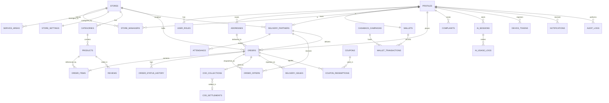

# Ramu Kaka — Proposed Database Schema

| Field | Value |
|---|---|
| Database | Supabase PostgreSQL (CONFIRMED, `[PDF §7]`) |
| Status | **PROPOSED, conceptual model only** |

> ⚠️ **No tables, SQL or migrations have been created.** This document is a logical model for review. Physical DDL is written in **Level 2**, after approval.
>
> Entities and fields are derived from the PDF's requirements. Fields or entities that depend on an open decision are marked with the `PA-xx` item.

---

## 1. Conventions (RECOMMENDATION)

- Primary keys: `uuid`.
- Every table has `created_at` and `updated_at` (timestamptz, UTC).
- Money is stored as an **integer number of paise** (`*_paise`), never as a float.
- Records are soft-deleted or deactivated with `is_active` / `status`. Business records are not hard-deleted.
- Enumerations are Postgres enums or check-constrained text (chosen in Level 2).
- RLS is enabled on **every** table.

## 2. Entity-Relationship Overview

## 3. Entities

### 3.1 Identity and Access

**profiles**: one row per authenticated user (linked to Supabase `auth.users`)

| Field | Type | Notes / source |
|---|---|---|
| id | uuid (= auth user id) | FR-CU-01 |
| full_name | text | |
| phone | text, unique | OTP login |
| preferred_language | enum `hi` \| `en` \| `bho` | FR-CU-03 |
| status | enum `active` \| `suspended` | FR-SA-03 |

**user_roles**: a user may have several roles (BR-07, BR-23)

| Field | Type | Notes |
|---|---|---|
| user_id | uuid → profiles | |
| role | enum `customer` \| `delivery_partner` \| `store_manager` \| `super_admin` | Admin sub-roles **PA-44** |

**store_managers**: manager ↔ store assignment (BR-01)

| Field | Type | Notes |
|---|---|---|
| store_id | uuid → stores | |
| user_id | uuid → profiles | One manager per store, or several, is **PA-41** |
| permissions | jsonb / flag columns | e.g. `can_create_coupons`, `can_apply_surge`, `can_edit_prices`. Final list **PA-32** |
| status | enum `pending` \| `approved` \| `suspended` | FR-SA-03 |

### 3.2 Stores and Service Areas

**stores**

| Field | Type | Notes |
|---|---|---|
| id, name, code | | |
| address_text, location (lat/lng) | | |
| district, town | text | Initial market: Jamui `[PDF §1]` |
| is_open | boolean | FR-SM-04, BR-09 |
| status | enum `pending` \| `active` \| `suspended` | FR-SA-03 |

**store_settings**: operating limits set by SA (FR-SA-04, FR-SA-12, BR-25)

| Field | Type | Notes |
|---|---|---|
| store_id | uuid → stores | |
| base_delivery_charge_paise | int | **PA-19** |
| min_order_value_paise | int | **PA-19** |
| max_surge_paise / max_surge_percent | int | **PA-05** |
| current_surge_paise / percent | int | FR-SM-05 |
| offer_timeout_seconds | int | **PA-03** |
| opening_hours | jsonb | **PA-33** |

**service_areas**: BR-02

| Field | Type | Notes |
|---|---|---|
| store_id | uuid → stores | |
| type | enum `radius` \| `polygon` \| `pincode` | Model **PA-01 / PA-13** |
| center + radius_m / polygon / pincodes | | PostGIS optional (RECOMMENDATION) |
| is_active | boolean | |

### 3.3 Catalog and Inventory

> Ownership model is **PA-31**. Shown below: the **store-owned catalog** option, which is closest to the PDF wording ("managers create categories and products"). The alternative is a global `products` table plus a `store_products` table for price and stock.

**categories**

| Field | Type | Notes |
|---|---|---|
| store_id | uuid → stores (nullable if platform-wide) | FR-SM-06, FR-SA-05 |
| name_hi / name_en / name_bho | text | Localized names (RECOMMENDATION) |
| icon / image_url | text | |
| sort_order, is_active | | Deactivate, don't delete |

**products**

| Field | Type | Notes |
|---|---|---|
| category_id | uuid → categories | |
| store_id | uuid → stores | |
| name_* / description_* | text | Localized |
| unit_label | text | e.g. "20 L jar", "1 L bottle" |
| price_paise | int | FR-SM-07. Pricing model **PA-02** |
| stock_qty | int | FR-SM-10 |
| is_available, is_active | boolean | BR-09 |
| images | text[] / separate table | |
| ai_aliases | text[] | RECOMMENDATION: spoken synonyms ("jar", "bada bottle", "paani ka dibba") to help the AI match products |

**stock_movements** (RECOMMENDATION): an audit trail for stock changes (manual adjustment, reservation, release).

### 3.4 Customers

**addresses**

| Field | Type | Notes |
|---|---|---|
| user_id | uuid → profiles | FR-CU-02 |
| label | text | "Home", "Shop" |
| address_line, landmark, town, district, pincode | text | |
| location (lat/lng) | | Needed for the service-area check (**PA-36**) |
| is_default | boolean | |

### 3.5 Orders and Delivery

**orders**

| Field | Type | Notes |
|---|---|---|
| id, order_number | | Readable order number (RECOMMENDATION) |
| customer_id | uuid → profiles | |
| store_id | uuid → stores | Routing **PA-13** |
| address_id + address_snapshot | uuid + jsonb | Snapshot so later address edits don't change past orders |
| delivery_partner_id | uuid → delivery_partners, nullable | **Set once, atomically** (BR-03) |
| status | enum | Proposed list: `placed`, `accepted`, `picked_up`, `out_for_delivery`, `delivered`, `cancelled`, `failed`. Final list **PA-39** |
| channel | enum `voice` \| `manual` | Needed to compare voice and manual ordering, and for KPI-09 |
| subtotal_paise, delivery_charge_paise, surge_paise, discount_paise, wallet_used_paise, total_paise | int | Computed server-side (BR-21). `wallet_used` depends on **PA-27** |
| payment_method | enum `cod` | Online payment in Phase 2 |
| confirmed_at | timestamptz | BR-04 evidence |
| quote_id | uuid | Link to the confirmed quote |
| idempotency_key | text, unique | NFR-REL-01 |
| cancel_reason, cancelled_by | | **PA-16** |

**order_items**: product_id, product_name_snapshot, unit_price_paise, quantity, line_total_paise.

**order_quotes** (RECOMMENDATION, ADR-03): a short-lived, server-computed price breakdown that the customer confirms. It has an expiry.

**order_status_history**: order_id, from_status, to_status, changed_by, changed_at, note. Used for audit and fulfilment-time KPIs (KPI-03).

**order_offers**: dispatch log (FR-DP-04/05, **PA-03**)

| Field | Type | Notes |
|---|---|---|
| order_id, delivery_partner_id | | |
| status | enum `offered` \| `accepted` \| `rejected` \| `expired` \| `superseded` | |
| offered_at, responded_at | timestamptz | |

**delivery_issues**: FR-DP-11

| Field | Type | Notes |
|---|---|---|
| order_id, reported_by | | |
| type | enum `failed_delivery` \| `other` | Reason list **PA-17** |
| reason, note, photo_path | | |
| resolution_status | | |

### 3.6 Delivery Partners and Attendance

**delivery_partners**

| Field | Type | Notes |
|---|---|---|
| user_id | uuid → profiles | |
| store_id | uuid → stores | One store each is **PA-14** |
| duty_status | enum `on_duty` \| `off_duty` | FR-DP-02 |
| kyc fields | | **PA-14** |
| status | enum `pending` \| `active` \| `suspended` | |

**attendance**: FR-DP-02, FR-DP-03

| Field | Type | Notes |
|---|---|---|
| delivery_partner_id, store_id | | |
| duty_on_at, duty_off_at | timestamptz | |
| start_photo_path | text (private bucket) | |
| start_location (lat/lng) | | **PA-06** |
| verification_status | enum `pending` \| `verified` \| `rejected` | |
| verified_by, verified_at | | **PA-06** |

### 3.7 Payments, COD and Wallet

**cod_collections**: FR-DP-10

| Field | Type | Notes |
|---|---|---|
| order_id (unique) | | |
| delivery_partner_id | | |
| expected_paise, collected_paise | int | Mismatch flag |
| collected_at | | |
| settlement_id | uuid, nullable | |

**cod_settlements**: FR-SM-12, FR-SA-08 (rules **PA-08**)

| Field | Type | Notes |
|---|---|---|
| store_id, delivery_partner_id | | |
| amount_paise | int | |
| received_by (manager), received_at | | |
| status | enum `pending` \| `settled` \| `disputed` | |

**wallets**: one per customer. The balance is **derived** from the ledger, with an optional cached column kept up to date by the ledger function.

**wallet_transactions**: **append-only ledger** (BR-05, BR-17)

| Field | Type | Notes |
|---|---|---|
| wallet_id | | |
| direction | enum `credit` \| `debit` | |
| amount_paise | int > 0 | |
| type | enum `cashback` \| `promo` \| `refund` \| `compensation` \| `order_payment` \| `reversal` \| `expiry` | `order_payment` and `expiry` depend on **PA-27** |
| reference_type / reference_id | | order, campaign, complaint |
| reason | text | Required for admin credits |
| created_by, approved_by | uuid | BR-18. Approval flow **PA-44** |
| balance_after_paise | int | Makes audits easier |
| idempotency_key | unique | Prevents double credits |

No UPDATE or DELETE is allowed on this table (enforced by RLS/privileges in Level 2).

### 3.8 Offers

**coupons**: FR-CU-12, FR-SM-13, FR-SA-06 (policy **PA-04**, **PA-29**)

| Field | Type | Notes |
|---|---|---|
| code | text | |
| scope | enum `platform` \| `store` | store_id when store-scoped |
| discount_type | enum `flat` \| `percent` | |
| value, max_discount_paise, min_order_paise | | |
| valid_from, valid_to | | |
| usage_limit_total, usage_limit_per_user | | |
| created_by, is_active | | |

**coupon_redemptions**: coupon_id, order_id, customer_id, discount_paise.

**cashback_campaigns**: scope (platform/store), rule parameters (**PA-04**, **PA-30**), budget_paise, active window, created_by.

### 3.9 Feedback

**reviews**: product_id, order_id, customer_id, rating (1–5), comment, status (visible/hidden, **PA-25**), manager_reply.

**complaints**: customer_id, order_id (optional), store_id, category, description, status (`open` \| `in_progress` \| `resolved`), assigned_to, resolution_note. Intake channel **PA-26**.

### 3.10 AI Usage — FR-AI-07, FR-SA-11, BR-08

**ai_sessions**: customer_id, language, started_at, ended_at, outcome (`order_placed` \| `fell_back_to_manual` \| `abandoned`), order_id.

**ai_usage_logs**

| Field | Type | Notes |
|---|---|---|
| session_id, customer_id | | Needed for cost per customer |
| model | text | **PA-23** |
| input_tokens, output_tokens, audio_seconds_in, audio_seconds_out | numeric | |
| estimated_cost_micros | bigint | Cost from a configurable price table |
| latency_ms | int | |
| created_at | | |

**ai_pricing_config** (RECOMMENDATION): model → unit prices, so cost estimates stay correct when Gemini prices change.

### 3.11 Notifications, Settings and Audit

- **device_tokens**: user_id, token, platform, last_seen.
- **notifications**: user_id, type, title/body (localized), payload, read_at.
- **platform_settings**: key/value for platform-wide operational settings (FR-SA-05).
- **audit_logs**: actor_id, action, entity_type, entity_id, before/after (jsonb), created_at. Covers manager and admin actions on prices, money and accounts.

## 4. Access Control Matrix (RLS intent)

| Entity | Customer | Delivery Partner | Store Manager | Super Admin |
|---|---|---|---|---|
| profiles | own | own; assigned customers' name/phone (limited) | own store's DPs; customers who ordered from the store (limited) | all |
| addresses | own CRUD | assigned order snapshot only | via order snapshot | all |
| stores / settings | read active | own store (read) | own store (limited update) | all |
| categories / products | read active | read | own store CRUD (per permissions) | all |
| orders | own (read; create via function) | offered/assigned (read; status via function) | own store (read; assign via function) | all |
| order_offers | — | own | own store | all |
| attendance | — | own (create via function) | own store (verify) | all |
| cod_collections / settlements | — | own | own store | all |
| wallets / wallet_transactions | own (read only) | — | — (**PENDING**: should managers see this?) | all (credit via function) |
| coupons | read eligible | — | own store (per permissions) | all |
| reviews / complaints | own | — | own store | all |
| ai_sessions / ai_usage_logs | — (server writes) | — | — | read |
| audit_logs | — | — | — | read |

## 5. Data Integrity Rules for Level 2

| Rule | Mechanism (to implement) | Source |
|---|---|---|
| One DP per order | Conditional update + `delivery_partner_id` set once | BR-03 |
| Wallet is append-only | No UPDATE/DELETE privileges; corrections via `reversal` entries | BR-05 |
| No duplicate orders on retry | Unique `idempotency_key` | NFR-REL-01 |
| Stock never negative | Check constraint + transactional decrement | BR-09 |
| Money as integers | `*_paise` integer columns | Recommendation |
| Store isolation | RLS on `store_id` | BR-01 |

## 6. Open Schema Decisions

PA-01, PA-03, PA-05, PA-13, PA-14, PA-17, PA-19, PA-25, PA-27, PA-31, PA-32, PA-34, PA-39, PA-41, PA-44. See [BUSINESS_RULES.md §4](./BUSINESS_RULES.md#4-pending-approval-register).
