# Ramu Kaka — Proposed Database Schema

| Field | Value |
|---|---|
| Database | Supabase PostgreSQL (CONFIRMED, `[PDF §7]`) |
| Status | **PROPOSED, conceptual model only** |
| Last updated | 2026-10-30 (audit corrections) |

> ⚠️ **No tables, SQL or migrations have been created.** This document is a logical model for review. Physical DDL is written in **Level 2**, after approval.
>
> Entities and fields are derived from the PDF's requirements. Fields or entities that depend on an open decision are marked with the `PA-xx` item.

---

## 1. Conventions (RECOMMENDATION)

- Primary keys: `id uuid` on every table, unless stated otherwise.
- Every table has `created_at` and `updated_at` (timestamptz, UTC).
- Money is stored as an **integer number of paise** (`*_paise`), never as a float.
- Records are soft-deleted or deactivated with `is_active` / `status`. Business records are not hard-deleted.
- Enumerations are Postgres enums or check-constrained text (chosen in Level 2).
- Status values are **lowercase snake_case** (e.g. `out_for_delivery`).
- "Delivery request" means a dispatch to a DP. "Offer" means a promotional offer only.
- RLS is enabled on **every** table.

## 2. Entity-Relationship Overview

```mermaid
erDiagram
  PROFILES ||--o{ USER_ROLES : has
  PROFILES ||--o{ ADDRESSES : saves
  PROFILES ||--o| WALLETS : "owns (customers only)"
  WALLETS ||--o{ WALLET_TRANSACTIONS : records
  STORES ||--o{ STORE_MANAGERS : managed_by
  PROFILES ||--o{ STORE_MANAGERS : is
  STORES ||--o{ SERVICE_AREAS : serves
  STORES ||--|| STORE_SETTINGS : configured_by
  STORES ||--o{ CATEGORIES : has
  CATEGORIES ||--o{ PRODUCTS : contains
  STORES ||--o{ PRODUCTS : stocks
  PRODUCTS ||--o{ STOCK_MOVEMENTS : tracked_by
  STORES ||--o{ DELIVERY_PARTNERS : employs
  PROFILES ||--o| DELIVERY_PARTNERS : is
  DELIVERY_PARTNERS ||--o{ ATTENDANCE : marks
  PROFILES ||--o{ ORDER_QUOTES : requests
  ORDER_QUOTES ||--o| ORDERS : confirmed_as
  PROFILES ||--o{ ORDERS : places
  STORES ||--o{ ORDERS : fulfils
  ADDRESSES ||--o{ ORDERS : delivered_to
  ORDERS ||--|{ ORDER_ITEMS : contains
  PRODUCTS ||--o{ ORDER_ITEMS : referenced_by
  ORDERS ||--o{ ORDER_STATUS_HISTORY : logs
  ORDERS ||--o{ DELIVERY_REQUESTS : dispatched_as
  DELIVERY_PARTNERS ||--o{ DELIVERY_REQUESTS : receives
  DELIVERY_PARTNERS ||--o{ ORDERS : delivers
  ORDERS ||--o| COD_COLLECTIONS : paid_by
  COD_SETTLEMENTS ||--o{ COD_COLLECTIONS : settles
  STORES ||--o{ COD_SETTLEMENTS : reconciles
  ORDERS ||--o{ DELIVERY_ISSUES : reported_on
  STORES ||--o{ COUPONS : "scopes (store coupons)"
  COUPONS ||--o{ COUPON_REDEMPTIONS : used_in
  ORDERS ||--o{ COUPON_REDEMPTIONS : applies
  STORES ||--o{ CASHBACK_CAMPAIGNS : "scopes (store campaigns)"
  CASHBACK_CAMPAIGNS ||--o{ WALLET_TRANSACTIONS : funds
  PRODUCTS ||--o{ REVIEWS : rated_in
  ORDERS ||--o{ REVIEWS : reviewed_from
  STORES ||--o{ REVIEWS : receives
  PROFILES ||--o{ COMPLAINTS : raises
  STORES ||--o{ COMPLAINTS : handles
  ORDERS ||--o{ COMPLAINTS : about
  PROFILES ||--o{ AI_SESSIONS : starts
  AI_SESSIONS ||--o{ AI_USAGE_LOGS : meters
  AI_SESSIONS ||--o| ORDER_QUOTES : pending_quote
  AI_SESSIONS ||--o| ORDERS : resulted_in
  AI_PRICING_CONFIG ||--o{ AI_USAGE_LOGS : prices
  PROFILES ||--o{ DEVICE_TOKENS : registers
  PROFILES ||--o{ NOTIFICATIONS : receives
  PROFILES ||--o{ AUDIT_LOGS : performs
  PLATFORM_SETTINGS }o--|| PROFILES : updated_by
```

## 3. Entities

### 3.1 Identity and Access

**profiles**: one row per authenticated user (linked to Supabase `auth.users`)

| Field | Type | Notes / source |
|---|---|---|
| id | uuid (= auth user id) | FR-CU-01 |
| full_name | text | DERIVED (FR-DP-07 shows the customer's name). **User-editable** |
| phone | text, unique | OTP login (BR-26). **Protected**: not user-editable (NFR-SEC-09) |
| preferred_language | enum `hi` \| `en` \| `bho` | FR-CU-03. **User-editable** |
| status | enum `active` \| `suspended` | FR-SA-03. **Protected**: admin functions only. Checked on every request (NFR-SEC-08) |

**user_roles**: a user may have several roles (BR-07, BR-23). Changed only by admin functions.

| Field | Type | Notes |
|---|---|---|
| user_id | uuid → profiles | |
| role | enum `customer` \| `delivery_partner` \| `store_manager` \| `super_admin` | Admin sub-roles **PA-44** |

**store_managers**: manager ↔ store assignment (BR-01)

| Field | Type | Notes |
|---|---|---|
| store_id | uuid → stores | |
| user_id | uuid → profiles | One manager per store, or several, is **PA-41** |
| permissions | jsonb / flag columns | e.g. `can_create_coupons`, `can_apply_surge`, `can_edit_prices`. Final list **PA-32** |
| status | enum `pending` \| `approved` \| `suspended` | FR-SA-03. Checked on every request (NFR-SEC-08) |

### 3.2 Stores and Service Areas

**stores**: one row per store / warehouse location (whether store and warehouse are the same is **PA-54**)

| Field | Type | Notes |
|---|---|---|
| id, name, code | | |
| address_text, location (lat/lng) | | Also the warehouse location for attendance (BR-24, **PA-54**) |
| district, town | text | Initial market: Jamui `[PDF §1]` |
| is_open | boolean | FR-SM-04, BR-09. Precedence with admin settings **PA-50** |
| status | enum `pending` \| `active` \| `suspended` | FR-SA-03 |

**store_settings**: operating limits set by SA (FR-SA-04, FR-SA-12, BR-25)

| Field | Type | Notes |
|---|---|---|
| store_id | uuid → stores (unique) | |
| base_delivery_charge_paise | int | **PA-19** |
| min_order_value_paise | int | **PA-19** |
| max_surge_paise / max_surge_percent | int | **PA-05** |
| current_surge_paise / percent | int | FR-SM-05 |
| request_timeout_seconds | int | Delivery request timeout, **PA-03** |
| opening_hours | jsonb | **PA-33** |
| admin_open_override | enum / nullable | FR-SA-04. Precedence **PA-50** |

**service_areas**: BR-02

| Field | Type | Notes |
|---|---|---|
| store_id | uuid → stores | |
| type | enum `radius` \| `polygon` \| `pincode` | Model **PA-01 / PA-13** |
| center + radius_m / polygon / pincodes | | PostGIS optional (RECOMMENDATION) |
| is_active | boolean | |

**platform_settings**: platform-wide operational settings (FR-SA-05). The list of keys is **PA-51**.

| Field | Type | Notes |
|---|---|---|
| key | text, unique | |
| value | jsonb | |
| updated_by | uuid → profiles | Super Admin |

### 3.3 Catalog and Inventory

> Ownership model is **PA-31**. Shown below: the **store-owned catalog** option, which is closest to the PDF wording ("managers create categories and products"). The alternative is a global `products` table plus a `store_products` table for price and stock. That alternative would also be how platform-wide products (FR-SA-05) are stored.
>
> All writes go through server functions (DR-11, ADR-01).

**categories**

| Field | Type | Notes |
|---|---|---|
| store_id | uuid → stores (nullable = platform-wide) | FR-SM-06, FR-SA-05 |
| name_hi / name_en / name_bho | text | Localized names (RECOMMENDATION) |
| icon / image_url | text | |
| sort_order, is_active | | Deactivate, don't delete |

**products**

| Field | Type | Notes |
|---|---|---|
| category_id | uuid → categories | |
| store_id | uuid → stores | Nullable only if PA-31 chooses a global catalog |
| name_* / description_* | text | Localized |
| unit_label | text | e.g. "20 L jar", "1 L bottle" |
| price_paise | int | FR-SM-07. Pricing model **PA-02** |
| stock_qty | int ≥ 0 | FR-SM-10 |
| is_available, is_active | boolean | BR-09 |
| images | text[] / separate table | |
| ai_aliases | text[] | RECOMMENDATION: spoken synonyms ("jar", "bada bottle", "paani ka dibba") to help the AI match products |

**stock_movements**: audit trail for every stock change (DR-11)

| Field | Type | Notes |
|---|---|---|
| product_id | uuid → products | |
| change_qty | int (+/−) | |
| reason | enum `manual_adjustment` \| `order_reserved` \| `order_released` \| `order_delivered` | Which order events apply depends on **PA-49** |
| order_id | uuid, nullable | |
| actor_id | uuid → profiles | |

**Suppliers:** no entity is proposed until **PA-59** decides whether supplier inventory is in Phase 1 scope.

### 3.4 Customers

**addresses**

| Field | Type | Notes |
|---|---|---|
| user_id | uuid → profiles | FR-CU-02 |
| label | text | "Home", "Shop" |
| address_line, landmark, town, district, pincode | text | |
| location (lat/lng) | | Needed for the service-area check (**PA-36**) |
| is_default | boolean | |

### 3.5 Orders and Delivery

**order_quotes**: a short-lived, server-computed breakdown that the customer must confirm (ADR-03)

| Field | Type | Notes |
|---|---|---|
| customer_id, store_id, address_id | | |
| items | jsonb | product, quantity, unit price |
| subtotal / delivery_charge / surge / discount / wallet_used / total `_paise` | int | Computed server-side |
| coupon_id | uuid, nullable | |
| channel | enum `voice` \| `manual` | |
| ai_session_id | uuid, nullable | Set when the quote was created in a voice session |
| expires_at | timestamptz | |
| status | enum `active` \| `confirmed` \| `expired` \| `superseded` | |

**orders**

| Field | Type | Notes |
|---|---|---|
| id, order_number | | Readable order number (RECOMMENDATION) |
| customer_id | uuid → profiles | |
| store_id | uuid → stores | Routing **PA-13** |
| address_id + address_snapshot | uuid + jsonb | Snapshot so later address edits don't change past orders |
| delivery_partner_id | uuid → delivery_partners.id, nullable | **Set once, atomically** (BR-03) |
| status | enum | `placed`, `accepted`, `picked_up`, `out_for_delivery`, `delivered`, `cancelled`, `failed`. Final list **PA-39** |
| channel | enum `voice` \| `manual` | Needed to compare voice and manual ordering, and for KPI-09 |
| subtotal_paise, delivery_charge_paise, surge_paise, discount_paise, wallet_used_paise, total_paise | int | Copied from the confirmed quote (BR-21). `wallet_used` depends on **PA-27** |
| payment_method | enum `cod` | Online payment in Phase 2 |
| quote_id | uuid → order_quotes (unique) | Link to the confirmed quote |
| confirmed_at | timestamptz | BR-04 evidence |
| confirmation_method | enum `tap` \| `voice` | FR-AI-05 AC6, DR-10 |
| ai_session_id | uuid, nullable | Voice orders (KPI-09) |
| idempotency_key | text, unique | NFR-REL-01 |
| cancel_reason, cancelled_by | | **PA-16** |

**order_items**: product_id, product_name_snapshot, unit_price_paise, quantity, line_total_paise.

**order_status_history**: order_id, from_status, to_status, changed_by, changed_at, note. Used for audit and fulfilment-time KPIs (KPI-03).

**delivery_requests**: dispatch log (FR-DP-04/05, **PA-03**). This replaces the earlier name `order_offers`.

| Field | Type | Notes |
|---|---|---|
| order_id, delivery_partner_id | | |
| status | enum `pending` \| `accepted` \| `rejected` \| `expired` \| `withdrawn` | `withdrawn` = another DP accepted first |
| sent_at, responded_at | timestamptz | |

What the DP can see before accepting is **PA-56**. It is served by a restricted view, not the full order row.

**delivery_issues**: FR-DP-11

| Field | Type | Notes |
|---|---|---|
| order_id, reported_by | | |
| type | enum `failed_delivery` \| `other` | Reason list **PA-17** |
| reason, note, photo_path | | |
| resolution_status | | |

### 3.6 Delivery Partners and Attendance

**delivery_partners**

| Field | Type | Notes |
|---|---|---|
| id | uuid (PK) | Referenced by orders, delivery_requests, attendance, COD |
| user_id | uuid → profiles (unique) | |
| store_id | uuid → stores | One store each is **PA-14** (assumption A-03) |
| duty_status | enum `on_duty` \| `off_duty` | FR-DP-02 |
| kyc / profile fields | | **PA-14** |
| status | enum `pending` \| `active` \| `suspended` | Checked on every request (NFR-SEC-08) |

**attendance**: FR-DP-02, FR-DP-03

| Field | Type | Notes |
|---|---|---|
| delivery_partner_id, store_id | | |
| duty_on_at, duty_off_at | timestamptz | |
| start_photo_path | text (private bucket) | |
| start_location (lat/lng) | | **PA-06** |
| verification_status | enum `pending` \| `verified` \| `rejected` | |
| verified_by, verified_at | | **PA-06** |

### 3.7 Payments, COD and Wallet

**cod_collections**: FR-DP-10

| Field | Type | Notes |
|---|---|---|
| order_id (unique) | | |
| delivery_partner_id | | |
| expected_paise, collected_paise | int | Mismatch flag |
| collected_at | | |
| settlement_id | uuid → cod_settlements, nullable | |

**cod_settlements**: FR-SM-12, FR-SA-08 (rules **PA-08**)

| Field | Type | Notes |
|---|---|---|
| store_id, delivery_partner_id | | |
| amount_paise | int | |
| received_by (manager), received_at | | |
| status | enum `pending` \| `settled` \| `disputed` | |

**wallets**: one per **customer** (users with the `customer` role only; DPs, managers and admins have no wallet).

| Field | Type | Notes |
|---|---|---|
| customer_id | uuid → profiles (unique) | |
| cached_balance_paise | int | Kept up to date by the ledger function only. The source of truth is the ledger (DR-05) |

All ledger writes for a wallet lock the wallet row first (NFR-SEC-12).

**wallet_transactions**: **append-only ledger** (BR-05, BR-17)

| Field | Type | Notes |
|---|---|---|
| wallet_id | | |
| direction | enum `credit` \| `debit` | |
| amount_paise | int > 0 | |
| type | enum `cashback` \| `promo` \| `refund` \| `compensation` \| `order_payment` \| `reversal` \| `expiry` | `order_payment` and `expiry` depend on **PA-27** |
| reference_type / reference_id | | order, campaign, complaint |
| campaign_id | uuid → cashback_campaigns, nullable | Automatic campaign credits only if **PA-52** allows them |
| reason | text | Required for admin credits |
| created_by, approved_by | uuid | BR-18. Approval flow **PA-44**. Allowed actors **PA-52** |
| balance_after_paise | int | Correct because writes are serialized (NFR-SEC-12) |
| idempotency_key | unique | Prevents double credits |

No UPDATE or DELETE is allowed on this table (enforced by privileges in Level 2).

### 3.8 Promotional Offers

**coupons**: FR-CU-12, FR-SM-13, FR-SA-06 (policy **PA-04**, **PA-29**)

| Field | Type | Notes |
|---|---|---|
| code | text | |
| scope | enum `platform` \| `store` | |
| store_id | uuid → stores, nullable | Required when scope = store |
| discount_type | enum `flat` \| `percent` | |
| value, max_discount_paise, min_order_paise | | |
| valid_from, valid_to | | |
| usage_limit_total, usage_limit_per_user | | |
| created_by, is_active | | |

**coupon_redemptions**: coupon_id, order_id, customer_id, discount_paise.

**cashback_campaigns**: scope (platform/store), store_id (nullable), rule parameters (**PA-04**, **PA-30**), budget_paise, active window, created_by. Whether campaigns credit wallets automatically is **PA-52**.

### 3.9 Feedback

**reviews**

| Field | Type | Notes |
|---|---|---|
| product_id | uuid → products | FR-CU-13 |
| order_id | uuid → orders | Eligibility **PA-25** |
| store_id | uuid → stores | Copied from the order, so manager scoping works whatever PA-31 decides |
| customer_id | | |
| rating (1–5), comment | | |
| status (visible/hidden), manager_reply | | **PA-25** |

**complaints**

| Field | Type | Notes |
|---|---|---|
| customer_id | uuid → profiles | |
| order_id | uuid → orders, nullable | |
| store_id | uuid → stores | Manager scoping |
| type | enum `complaint` (+ `feedback` if **PA-26** makes it a separate type) | FR-SM-14 |
| category, description | | |
| status | `open` \| `in_progress` \| `resolved` | |
| assigned_to, resolution_note | | |

The intake channel is **PA-26**.

### 3.10 AI Usage — FR-AI-05, FR-AI-07, FR-SA-11, BR-08

**ai_sessions**

| Field | Type | Notes |
|---|---|---|
| customer_id, language | | |
| state | enum `collecting` \| `awaiting_confirmation` \| `order_placed` \| `fallback` \| `ended` | Server-owned state machine (ADR-04, DR-10) |
| pending_quote_id | uuid → order_quotes, nullable | The only quote that can be confirmed in this session |
| outcome | enum `order_placed` \| `fell_back_to_manual` \| `abandoned` | |
| order_id | uuid → orders, nullable | |
| started_at, ended_at | | |

**ai_usage_logs**: **one row per Gemini API call**, including tool-loop calls and the yes/no confirmation check

| Field | Type | Notes |
|---|---|---|
| session_id, customer_id | | Needed for cost per customer |
| turn_id | uuid | Groups the calls of one customer turn; turn totals = sum |
| purpose | enum `conversation` \| `confirmation_check` \| `speech` | |
| model | text | **PA-23** |
| input_tokens, output_tokens, audio_seconds_in, audio_seconds_out | numeric | |
| estimated_cost_micros | bigint | Millionths of `cost_currency` |
| cost_currency | text | Billing currency (e.g. USD). Reporting currency and exchange rate **PA-57** |
| latency_ms | int | |

**ai_pricing_config**: model → unit prices and currency, so cost estimates stay correct when Gemini prices change.

### 3.11 Notifications, Settings and Audit

- **device_tokens**: user_id, token, platform, last_seen.
- **notifications**: user_id, type, title/body (localized), payload, read_at. Backs the in-app notification inbox (FR-CU-10).
- **audit_logs**: actor_id, action, entity_type, entity_id, before/after (jsonb), created_at. Covers manager and admin actions on prices, stock, money and accounts (NFR-SEC-07, DR-11).

## 4. Access Control Matrix (RLS intent)

"via function" = no direct client write; a server function checks role, status and scope (ADR-01). Every row also requires the caller's account to be active (NFR-SEC-08).

| Entity | Customer | Delivery Partner | Store Manager | Super Admin |
|---|---|---|---|---|
| profiles | own (read; update `full_name`, `preferred_language` only) | own (same); assigned customers' name/phone via order view | own store's DPs; customers who ordered from the store (limited) | all (status via function) |
| user_roles | own (read) | own (read) | own (read) | all (via function) |
| addresses | own CRUD | assigned order snapshot only | via order snapshot | all |
| stores / store_settings | read active | own store (read) | own store (read; open/close & surge via function) | all (via function) |
| platform_settings | — | — | read | all (via function) |
| categories / products | read active | read | own store (read; writes via function, per permissions) | all |
| stock_movements | — | — | own store (read) | all |
| order_quotes | own (read; create via function) | — | — | all |
| orders | own (read; create via function) | assigned (read; status via function) | own store (read; assign via function) | all |
| delivery_requests | — | own (restricted pre-accept view, **PA-56**; respond via function) | own store | all |
| delivery_partners / attendance | — | own (duty and attendance via function) | own store (verify via function) | all |
| cod_collections / settlements | — | own | own store (settle via function) | all |
| wallets / wallet_transactions | own (read only) | — | **PA-58** | all (credit via function) |
| coupons / cashback_campaigns | read eligible | — | own store (via function, per permissions) | all |
| reviews / complaints | own | — | own store | all |
| ai_sessions / ai_usage_logs / ai_pricing_config | — (server writes) | — | — | read |
| notifications / device_tokens | own | own | own | all |
| audit_logs | — | — | — | read |

## 5. Data Integrity Rules for Level 2

| Rule | Mechanism (to implement) | Source |
|---|---|---|
| One DP per order | Conditional update + `delivery_partner_id` set once | BR-03 |
| Wallet is append-only | No UPDATE/DELETE privileges; corrections via `reversal` entries | BR-05 |
| Correct balances under concurrency | Per-wallet row lock + idempotency key | NFR-SEC-12 |
| No duplicate orders on retry | Unique `idempotency_key` | NFR-REL-01 |
| One order per quote | Unique `orders.quote_id` | ADR-03 |
| Only the pending quote can be confirmed in a voice session | `ai_sessions.pending_quote_id` check in place-order | DR-10 |
| Stock never negative | Check constraint + transactional change; timing **PA-49** | BR-09 |
| Every stock change audited | `stock_movements` row per change | DR-11 |
| Money as integers | `*_paise` integer columns | Recommendation |
| Store isolation | RLS on `store_id` | BR-01 |
| Suspended accounts blocked | Status check in every policy and function | NFR-SEC-08 |

## 6. Open Schema Decisions

PA-01, PA-03, PA-05, PA-13, PA-14, PA-17, PA-19, PA-25, PA-26, PA-27, PA-31, PA-32, PA-34, PA-39, PA-41, PA-44, PA-49, PA-50, PA-51, PA-52, PA-54, PA-56, PA-57, PA-58, PA-59. See [BUSINESS_RULES.md §4](./BUSINESS_RULES.md#4-pending-approval-register).
