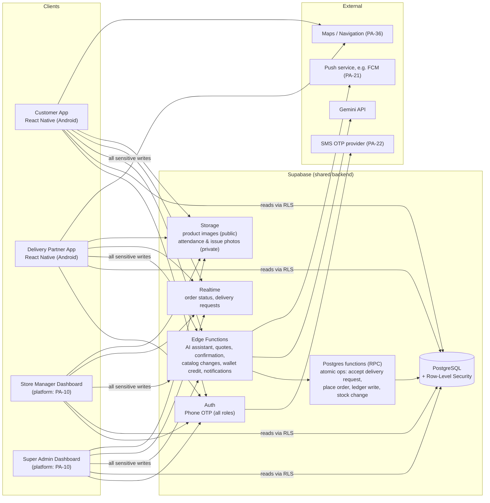

# Ramu Kaka — System Architecture

| Field | Value |
|---|---|
| Status | **PROPOSED – awaiting approval** |
| Confirmed inputs | Tech stack and architecture requirement from `[PDF §7]` |
| Last updated | 2026-10-30 (audit corrections) |

> Everything below the "Confirmed constraints" section is a **RECOMMENDATION** unless it is marked CONFIRMED or APPROVED DESIGN RULE. Choices that depend on open decisions cite the `PA-xx` item.

---

## 1. Confirmed Constraints `[PDF §7]`

1. Mobile apps are built with **React Native + TypeScript**. Android builds use **Android Studio**.
2. **Supabase Auth** with OTP for all roles (BR-26), **Supabase PostgreSQL**, and **Supabase server-side functions**.
3. **Gemini API** for the AI assistant.
4. **One shared backend and one database** for all panels, with **role-based access control**.
5. Wallet credits, order assignment, pricing and financial calculations are **validated server-side**.
6. **API keys must not be exposed in the mobile app.** Secret keys never ship. Platform-restricted public keys are **PA-53**.
7. GitHub for version control. Google Stitch for UI design.

## 2. High-Level Architecture



Storage use per panel: customers (review photos, only if **PA-25** allows them), DPs (attendance and issue photos), managers (product images), admin (read any).

## 3. Component Responsibilities

| Component | Responsibility | Notes |
|---|---|---|
| **Customer App** | Onboarding, addresses, catalog, cart, voice assistant UI, order tracking, wallet, coupons, reviews, notification inbox | Holds only the public Supabase anon key, which RLS protects |
| **Delivery Partner App** | Duty toggle, attendance photo, delivery requests, accept/reject, status updates, COD entry, failure reports | Needs camera, location and push permissions |
| **Store Manager Dashboard** | Store operations for **one** store | Platform **PA-10** |
| **Super Admin Dashboard** | Platform-wide administration and finance | Platform **PA-10** |
| **Supabase Auth** | Phone OTP for all roles (CONFIRMED, BR-26). Extra DP checks are **PA-15**. Issues JWTs. | Roles and status are looked up from tables on every request (NFR-SEC-08) |
| **PostgreSQL + RLS** | System of record. Enforces BR-01 (store isolation) and account status at the data layer. | See [DATABASE_SCHEMA.md](./DATABASE_SCHEMA.md) |
| **Postgres functions** | Transactional business operations where atomicity matters: accepting a delivery request, placing an order, ledger writes, stock changes | Satisfies BR-03, BR-05, NFR-SEC-12 |
| **Edge Functions** | Orchestration and calls to third parties: AI assistant, quotes, order confirmation, catalog changes, notifications, admin actions | The only place secrets live (NFR-SEC-11) |
| **Storage** | Product images (public bucket); attendance and issue photos (private bucket) | Retention **PA-34** |
| **Realtime** | Pushes order status changes and delivery-request events to subscribed clients | Lowers polling load on weak networks |

## 4. Key Architectural Decisions

### ADR-01 Shared backend with RLS — CONFIRMED (PDF), design is RECOMMENDED
All panels use the same Supabase project. **Reads** go directly to Postgres, and RLS policies limit them by role, account status and store.

**Writes that involve money, price, stock, catalog, assignment, status or account state** go **only** through Edge Functions or Postgres functions. Clients have no direct INSERT or UPDATE on those tables. This covers:
- orders and order items
- quotes
- delivery requests
- COD records
- wallet entries
- categories and products (DR-11)
- stock
- store settings
- user roles and status

Direct client writes are limited to low-risk own-data tables, such as the customer's own addresses and device tokens.

### ADR-02 Atomic order assignment — required by BR-03 and BR-10
Accepting a delivery request is one conditional database update: *"assign this order to DP X only if it has no DP yet and is still `placed`"*. If zero rows change, someone else already accepted it. This gives first-accept-wins without race conditions. Acceptance timeout and escalation to the manager depend on **PA-03** and **PA-40**.

### ADR-03 Server-side quote → confirm — required by BR-04, BR-12, BR-13, BR-21
1. The client (manual UI or AI) requests a **quote**: items, address, coupon. The server checks the service area, store open state, stock, price, surge, coupon and charges. It returns a short-lived `quote_id` with a breakdown.
2. The customer **confirms that quote**: a tap in the app, or a server-checked voice "yes" (ADR-04).
3. The server re-checks validity (store still open, stock still available, quote unexpired and owned by the customer) and creates the order in a single transaction.

Stock reservation and release timing is **PA-49**. The manual UI and the AI assistant use **the same quote and placement logic**, so voice ordering cannot skip any business rule.

### ADR-04 AI assistant: model proposes, server decides — APPROVED DESIGN RULE (DR-10)

**Principle:** the Gemini model can *look things up* and *ask for a quote*, but it **cannot place an order or change any amount**. A server-side state machine owns order placement.

**Model tools (read-only or quote-only):** `search_products`, `get_customer_addresses`, `get_quote`, `get_order_status`. There is **no** `place_order` tool.

**Server-side session states** (stored in `ai_sessions`):

| State | Meaning | Allowed transitions |
|---|---|---|
| `collecting` | Gathering product, quantity, address | → `awaiting_confirmation` (when the model obtains a valid quote) |
| `awaiting_confirmation` | A quote has been shown (text + summary card + speech). Its `pending_quote_id` is stored. | → `order_placed` (confirmed) · → `collecting` (customer changes something) · → `fallback` |
| `order_placed` | The server placed the order | session can end |
| `fallback` | Switched to manual ordering | session ends |

**How confirmation works:**
- **Tap:** the app calls `place-order` with the `pending_quote_id`. The server checks that this quote is the session's pending quote and belongs to the caller.
- **Voice:** when the session is `awaiting_confirmation`, the next voice turn first goes through a **separate yes/no confirmation check** on the server. This check is a narrow classification limited to "yes / no / unclear" for the pending quote, and it is separate from the conversational model. Only a clear "yes" makes the **server** call the place-order logic. "No" returns to `collecting`. "Unclear" → ask again or ask for a tap.
- The model's text can never trigger placement, even if it says "order placed". The server sets `state = order_placed` only after placement succeeds.

```mermaid
sequenceDiagram
  participant App as Customer App
  participant EF as Edge Function: ai-turn
  participant G as Gemini API
  participant CC as Server yes/no check
  participant DB as Postgres
  App->>EF: audio/text turn + session_id (JWT)
  EF->>DB: check account status, rate limit; load context + session state
  EF->>G: prompt + tools (search_products, get_customer_addresses, get_quote, get_order_status)
  G-->>EF: tool call get_quote(...)
  EF->>DB: compute quote (same logic as manual)
  EF->>G: tool result
  G-->>EF: reply text ("1 x 20L jar, ₹__, Home address. Confirm?")
  EF->>DB: session.state = awaiting_confirmation, pending_quote_id; log usage per Gemini call
  EF-->>App: reply text + audio + summary card (Confirm / Change buttons)
  alt Customer taps Confirm
    App->>EF: place-order(pending_quote_id)
  else Customer says "haan, bhej do"
    App->>EF: audio turn
    EF->>CC: classify yes/no/unclear for pending quote
    CC-->>EF: yes
  end
  EF->>DB: place order (re-validate quote, store, stock); confirmation_method = tap|voice
  EF-->>App: order_placed + order number
```

Other AI rules:
- The Gemini key is stored only in Edge Function secrets (NFR-SEC-11).
- Tool calls connect the model to real data (FR-AI-08). The model never states a price it did not receive from a tool, and it cannot set amounts (DR-09).
- **Rate limiting** per customer and per device, plus an account-status check, before any Gemini call (NFR-SEC-10).
- Usage is logged for **every Gemini call** (including tool-loop calls and the yes/no check), with a `turn_id` so per-turn totals can be computed (FR-AI-07).
- Reply audio is returned in the response, not stored, unless **PA-34** approves storage.
- Voice pipeline choice (**PA-23**). Options:
  - **(a)** Send audio directly to Gemini (multimodal input) and use Gemini or Google TTS for output.
  - **(b)** Use on-device or cloud speech-to-text first, then Gemini on text.
  - *Recommendation:* prototype (a) and (b) in an early AI spike and measure Bhojpuri accuracy and cost before choosing.

### ADR-05 Append-only wallet ledger — required by BR-05, BR-17, BR-18
- The wallet balance is the sum of ledger entries. Corrections are made by adding reversing entries, never by editing or deleting.
- Credits come only from server functions that check the role and policy. Who may credit is **PA-52**.
- Writes for one wallet are serialized with a row lock and require an idempotency key (NFR-SEC-12).

### ADR-06 Dashboards platform — **PENDING (PA-10), blocks Level 2**

| Option | Pros | Cons |
|---|---|---|
| A. Web app (React + TS) **(recommended)** | Better for tables, reports and data entry on desktop; shares TS types and API client | One more codebase (can share a monorepo) |
| B. Inside the React Native app (role-based screens) | One codebase; matches the PDF stack literally | Reports and tables are awkward on phones |
| C. React Native Web | One UI codebase | Extra complexity and tooling friction |

### ADR-07 App packaging — **PENDING (PA-11)**
Recommendation: two Android apps (Customer, Delivery Partner) in one monorepo with shared packages. This keeps the customer app small and simple, and gives the DP app different permissions (camera, background location).

## 5. Proposed Repository Layout (RECOMMENDATION, not created yet)

```
ramukaka/
├── apps/
│   ├── customer/          # React Native (Level 4+)
│   ├── delivery/          # React Native (Level 6+)
│   └── dashboard/         # Manager + Admin (platform per PA-10)
├── packages/
│   ├── shared-types/      # generated DB types, API contracts
│   ├── i18n/              # hi / en / bho string catalogs
│   └── ui/                # shared design tokens/components
├── supabase/
│   ├── migrations/        # SQL migrations (Level 2+)
│   ├── functions/         # Edge Functions
│   └── seed/              # non-production seed data and setup scripts
├── docs/                  # this documentation
├── CHANGELOG.md
├── CLAUDE.md
└── README.md
```
No code, migrations or React Native projects exist yet. They are created only at their approved level.

## 6. Environments (RECOMMENDATION)

| Env | Purpose | Data |
|---|---|---|
| `local` | Developer machines (Supabase CLI) | Seed data |
| `staging` | QA and UAT, internal APK builds | Synthetic data |
| `production` | Live pilot (Jamui) | Real data |

Secrets (Gemini key, SMS provider credentials, service-role key) live only in Supabase Edge Function secrets and CI secrets. They are never committed and never shipped to any client or dashboard (NFR-SEC-11).

## 7. Security Architecture

| Concern | Control |
|---|---|
| Authentication | Supabase phone OTP for all roles. JWT on every request. OTP rate limits (NFR-SEC-05). |
| Authorization | `user_roles` + store assignment, enforced by RLS and by checks inside every function (BR-01, BR-07) |
| Suspended accounts | Role **and** active status checked on every request, so suspension is immediate (NFR-SEC-08, DR-08) |
| Profile tampering | Only safe own-profile fields are editable; status, phone and roles change only through admin functions (NFR-SEC-09) |
| Secrets | Server-side only. Service-role key only in Edge Functions, and each function authorizes the caller explicitly (NFR-SEC-11) |
| Client keys | Supabase anon key only. Restricted Maps/FCM keys only if **PA-53** is approved |
| Sensitive ops | Edge Functions / Postgres functions with role checks (BR-21, ADR-01) |
| Catalog integrity | Price, stock and availability changes only through functions, with an audit entry (DR-11) |
| Money integrity | Append-only ledger, serialized per-wallet writes, idempotency keys, audit log (ADR-05, NFR-SEC-12) |
| AI safety | Model cannot place orders or set amounts. Server confirmation state machine (ADR-04). Rate limits, server-validated tool inputs (NFR-SEC-10). |
| PII | Customer phone and address visible to the assigned DP only (RECOMMENDATION). Pre-accept request contents are **PA-56**. Contact method and masking are **PA-24**. |
| Files | Private bucket + signed URLs for attendance and issue photos |
| Cost | AI usage logged per Gemini call (BR-08). Business caps are **PA-35**. |

## 8. Notifications (RECOMMENDATION, channel **PA-21**)

Push infrastructure is built in **Level 4** (customer status updates) and used in **Level 6** (delivery requests). Promotional notifications come in Level 8.

| Event | Recipient |
|---|---|
| Order placed | Customer (confirmation), eligible DPs (delivery request), store manager |
| Order accepted / picked up / out for delivery / delivered | Customer, manager |
| No acceptance within timeout (**PA-03**) | Manager |
| Delivery failed / issue reported | Customer, manager |
| Wallet credited | Customer |
| Attendance photo submitted | Manager |

Every notification is also stored in the `notifications` table, so the in-app inbox works.

## 9. Scalability Path (Phase 3)
- Categories, stores and service areas are data, not code (NFR-SCALE-01).
- More districts are added as new stores and service areas.
- Analytics can later move to read replicas or a warehouse if reporting load grows (Phase 2/3).
