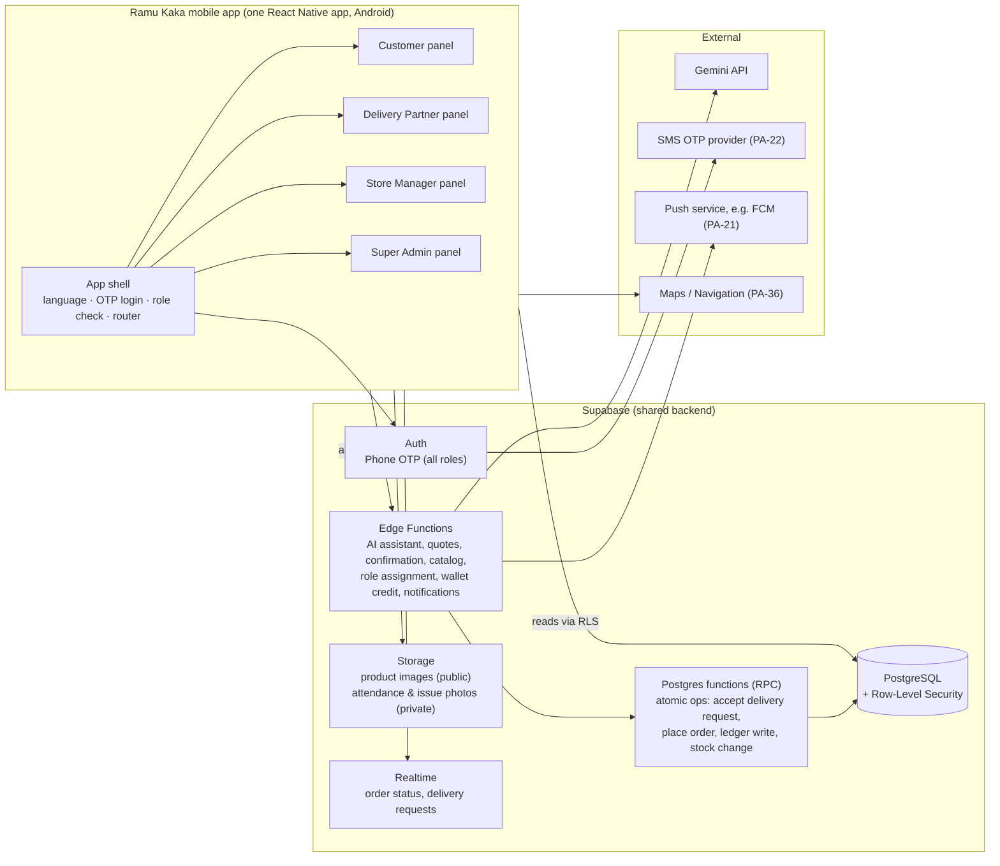

# Ramu Kaka — System Architecture

| Field | Value |
|---|---|
| Status | **PROPOSED – awaiting approval** |
| Confirmed inputs | Tech stack and architecture requirement from `[PDF §7]`; single-app decision (BR-27, BR-28) |
| Last updated | 2026-10-30 (single mobile app decision) |

> Everything below the "Confirmed constraints" section is a **RECOMMENDATION** unless it is marked CONFIRMED, APPROVED DECISION or APPROVED DESIGN RULE. Choices that depend on open decisions cite the `PA-xx` item.

---

## 1. Confirmed Constraints

From the PDF `[PDF §7]`:
1. The mobile application is built with **React Native + TypeScript**. Android builds use **Android Studio**.
2. **Supabase Auth** with OTP for all roles (BR-26), **Supabase PostgreSQL**, and **Supabase server-side functions**.
3. **Gemini API** for the AI assistant.
4. **One shared backend and one database** for all panels, with **role-based access control**.
5. Wallet credits, order assignment, pricing and financial calculations are **validated server-side**.
6. **API keys must not be exposed in the mobile app.** Secret keys never ship. Platform-restricted public keys are **PA-53**.
7. GitHub for version control. Google Stitch for UI design.

APPROVED DECISIONS (2026-10-30, see BUSINESS_RULES §4.0):
8. **One React Native mobile application** contains all four panels: Customer, Delivery Partner, Store Manager, Super Admin. There are **no separate apps and no web dashboard** (BR-27, decides PA-10 and PA-11).
9. After login, the app reads the user's **backend-assigned role** and opens the matching panel. Users cannot change their own role. All permissions are enforced on the backend. Each panel has its own navigation and screens. Device permissions are requested only when the role and feature need them (BR-28).

## 2. High-Level Architecture



The panels are separate sections of the same app. **Every request from any panel is checked by the backend** (RLS and server functions). The app's own role check only decides which screens to show.

## 3. Component Responsibilities

| Component | Responsibility | Notes |
|---|---|---|
| **App shell** | Language choice, OTP login, loading the user's role and status from the backend, routing to the right panel, "no access" / "account suspended" screens, push token registration | Shared by all roles |
| **Customer panel** | Addresses, catalog, cart, voice assistant, order tracking, wallet, coupons, reviews, notification inbox | Microphone permission only when the customer uses voice |
| **Delivery Partner panel** | Duty toggle, attendance photo, delivery requests, accept/reject, status updates, COD entry, failure reports | Camera and location permission only for DPs, only when needed |
| **Store Manager panel** | Store operations for **one** store: orders, delivery partners, catalog and stock, surge, reports, COD, offers, reviews and complaints | Designed for phone screens |
| **Super Admin panel** | Platform-wide administration and finance: stores, managers, DPs, customers, settings, offers, wallet credits, reports, AI cost | Designed for phone screens |
| **Supabase Auth** | Phone OTP for all roles (CONFIRMED, BR-26). Extra DP checks are **PA-15**. Issues JWTs. | Roles and status are read from tables on every request (NFR-SEC-08) |
| **PostgreSQL + RLS** | System of record. Enforces role, store isolation (BR-01) and account status at the data layer. | See [DATABASE_SCHEMA.md](./DATABASE_SCHEMA.md) |
| **Postgres functions** | Transactional business operations where atomicity matters | Satisfies BR-03, BR-05, NFR-SEC-12 |
| **Edge Functions** | Orchestration, third-party calls, role assignment, admin actions | The only place secrets live (NFR-SEC-11) |
| **Storage** | Product images (public bucket); attendance and issue photos (private bucket) | Retention **PA-34** |
| **Realtime** | Pushes order status changes and delivery-request events | Lowers polling load on weak networks |

## 4. Key Architectural Decisions

### ADR-01 Shared backend with RLS — CONFIRMED (PDF), design is RECOMMENDED
All panels use the same Supabase project. **Reads** go directly to Postgres, and RLS policies limit them by role, account status and store.

**Writes that involve money, price, stock, catalog, assignment, status, roles or account state** go **only** through Edge Functions or Postgres functions. The app has no direct INSERT or UPDATE on those tables. Direct writes are limited to low-risk own-data tables, such as the customer's own addresses and device tokens.

### ADR-02 Atomic order assignment — required by BR-03 and BR-10
Accepting a delivery request is one conditional database update: *"assign this order to DP X only if it has no DP yet and is still `placed`"*. If zero rows change, someone else already accepted it. This gives first-accept-wins without race conditions. Acceptance timeout and escalation to the manager depend on **PA-03** and **PA-40**.

### ADR-03 Server-side quote → confirm — required by BR-04, BR-12, BR-13, BR-21
1. The Customer panel (manual screens or AI) requests a **quote**: items, address, coupon. The server checks the service area, store open state, stock, price, surge, coupon and charges. It returns a short-lived `quote_id` with a breakdown.
2. The customer **confirms that quote**: a tap, or a server-checked voice "yes" (ADR-04).
3. The server re-checks validity and creates the order in a single transaction.

Stock reservation and release timing is **PA-49**.

### ADR-04 AI assistant: model proposes, server decides — APPROVED DESIGN RULE (DR-10)

**Principle:** the Gemini model can *look things up* and *ask for a quote*, but it **cannot place an order or change any amount**.

**Model tools (read-only or quote-only):** `search_products`, `get_customer_addresses`, `get_quote`, `get_order_status`. There is **no** `place_order` tool.

**Server-side session states** (stored in `ai_sessions`):

| State | Meaning | Allowed transitions |
|---|---|---|
| `collecting` | Gathering product, quantity, address | → `awaiting_confirmation` (when the model obtains a valid quote) |
| `awaiting_confirmation` | A quote has been shown (text + summary card + speech). Its `pending_quote_id` is stored. | → `order_placed` · → `collecting` · → `fallback` |
| `order_placed` | The server placed the order | session can end |
| `fallback` | Switched to manual ordering | session ends |

**How confirmation works:**
- **Tap:** the app calls `place-order` with the `pending_quote_id`. The server checks that this is the session's pending quote and belongs to the caller.
- **Voice:** when the session is `awaiting_confirmation`, the next voice turn first goes through a **separate server-side yes/no check**, limited to "yes / no / unclear" for the pending quote. Only a clear "yes" makes the **server** place the order. "No" returns to `collecting`. "Unclear" → ask again or ask for a tap.
- The model's words can never trigger placement.

```mermaid
sequenceDiagram
  participant App as Customer panel
  participant EF as Edge Function: ai-turn
  participant G as Gemini API
  participant CC as Server yes/no check
  participant DB as Postgres
  App->>EF: audio/text turn + session_id (JWT)
  EF->>DB: check role = customer, account status, rate limit; load session
  EF->>G: prompt + tools (search_products, get_customer_addresses, get_quote, get_order_status)
  G-->>EF: tool call get_quote(...)
  EF->>DB: compute quote (same logic as manual)
  EF->>G: tool result
  G-->>EF: reply text ("1 x 20L jar, ₹__, Home address. Confirm?")
  EF->>DB: session.state = awaiting_confirmation, pending_quote_id; log usage per Gemini call
  EF-->>App: reply text + audio + summary card (Confirm / Change)
  alt Customer taps Confirm
    App->>EF: place-order(pending_quote_id)
  else Customer says "haan, bhej do"
    App->>EF: audio turn
    EF->>CC: classify yes/no/unclear for pending quote
    CC-->>EF: yes
  end
  EF->>DB: place order (re-validate quote, store, stock); confirmation_method = tap|voice
  EF-->>App: order_placed + order number
```

Other AI rules:
- The Gemini key is stored only in Edge Function secrets (NFR-SEC-11).
- Rate limiting per customer and per device, plus a role and account-status check, runs before any Gemini call (NFR-SEC-10).
- Usage is logged for **every Gemini call**, with a `turn_id` (FR-AI-07).
- Reply audio is returned in the response, not stored, unless **PA-34** approves storage.
- The voice pipeline choice is **PA-23**. *Recommendation:* prototype Gemini audio input vs a separate speech-to-text step in an early AI spike, then decide.

### ADR-05 Append-only wallet ledger — required by BR-05, BR-17, BR-18
- The wallet balance is the sum of ledger entries. Corrections are reversing entries.
- Credits come only from server functions that check the role and policy. Who may credit is **PA-52**.
- Writes for one wallet are serialized with a row lock and require an idempotency key (NFR-SEC-12).

### ADR-06 Dashboards platform — **DECIDED (PA-10): inside the single mobile app**
The Store Manager and Super Admin "dashboards" named in the PDF are **panels inside the Ramu Kaka mobile app**. There is **no web dashboard** (BR-27).

Consequences:
- Manager and admin screens are designed **for phone screens first**: summary cards, filters, lists and simple forms instead of wide tables.
- Long reports use date filters and pagination. Whether finance reports also need a file export (for accountants) is **PA-62**.
- Managers and the owner must use a device the app supports. Android only, unless **PA-12** adds iOS.

### ADR-07 App packaging — **DECIDED (PA-11): one app**
One React Native app with one Play Store listing serves all four roles (BR-27). The earlier two-app recommendation was withdrawn.

### ADR-08 Login, role routing and panel isolation — APPROVED DECISION (BR-28)

**Flow:**
1. User logs in with phone OTP (BR-26).
2. The app asks the backend for the user's **roles, account status and (for staff) store assignment**.
3. The app opens the matching panel. Each panel has its **own navigation stack**. A screen in one panel cannot be opened from another panel's navigation.
4. If the account is suspended → "Account suspended" screen. If a staff account is pending approval → "Waiting for approval" screen. If no valid role → "No access" screen.
5. The role is **re-checked** when the app starts, when it returns from the background, when a push notification opens a screen, and whenever the backend returns `FORBIDDEN` or `ACCOUNT_SUSPENDED`. If the role or status has changed, the app routes again or logs out.

**Who gets which role:**
- A new phone number that registers by itself becomes a **customer only** (FR-CU-01, DR-12).
- Delivery Partner, Store Manager and Super Admin roles are assigned **only by the Super Admin** through a server function (FR-SA-03, BR-28). Assignment to a store is part of the same action.
- Users can never write to `user_roles` or their own `status` (NFR-SEC-09). The very first Super Admin is created by a one-time, server-side setup script (Level 3). It is never created from the app.
- Whether one phone number can hold more than one role (for example, a manager who also orders water at home) is **PA-60**. Until decided: one role per account.

**Where security lives:**
- The app's role check is **only for navigation and convenience**. Anyone could modify a copy of the app on their phone, so the app is never trusted.
- **Every API call and every database read is checked on the backend** for role, account status and store scope (RLS + server functions, NFR-SEC-08, NFR-SEC-14).

### ADR-09 Device permissions per role — APPROVED DECISION (BR-28)

The Android app must *declare* every permission any panel might use. The app *asks* the user for a permission only when their role and the current feature need it.

| Permission | Asked from | When | Notes |
|---|---|---|---|
| Notifications | All roles | After login, with an explanation | Android 13+ asks at runtime |
| Microphone | Customers | First time they tap the mic | Voice ordering (FR-AI-01) |
| Location (while using the app) | Customers (optional) | When pinning an address on a map | Typed address is the alternative (**PA-36**) |
| Location (while using the app) | Delivery partners | When going On Duty, if **PA-06** requires location | Attendance check |
| Camera | Delivery partners | When taking the work-start or issue photo | FR-DP-03, FR-DP-11 |
| Camera / photos | Store managers | When adding product images | FR-SM-07 |
| Phone call | — | Not needed | Calling opens the phone's dialer, which needs no permission |
| Background location | **Nobody** | Never | No PDF requirement for live tracking (DR-13). Avoiding it also avoids Google Play's strictest permission review. |

## 5. Technical Limitations and Security Implications of One App

| # | Topic | Limitation or risk | How the design handles it |
|---|---|---|---|
| L1 | **Everyone downloads all panels** | Customers' phones also contain the code for the Manager and Admin panels. Anyone can unpack an app and read its code, so admin screens and API names can be discovered. | No secrets in the app (BR-22). Hidden screens are **not** a security measure. Every action is authorized on the backend (ADR-08, NFR-SEC-14). Admin endpoints reject non-admins. |
| L2 | **App size and speed on low-end phones** | Four panels make the app bigger, and loading all of them slows startup. | Panels are loaded only when opened (lazy loading). Shared libraries are kept small. Size target NFR-PERF-05 stays. Startup target NFR-PERF-01 applies to the Customer panel. |
| L3 | **One release for all roles** | Fixing a manager screen means releasing a new app version to every customer, which goes through Play Store review. A bug in one panel can affect the whole app. | Staged rollouts in Play Console. Regression tests across all four panels before each release. *Recommendation:* over-the-air updates for JavaScript-only fixes (for example, Expo EAS Update), to be confirmed with the framework choice in Level 2. |
| L4 | **Play Store permissions review** | The single listing must justify every declared permission (camera, location, microphone) for its users. | Only foreground permissions. No background location (DR-13). Clear in-app explanations before each request. |
| L5 | **Manager and Admin on phones only** | Big reports and bulk data entry are harder on a small screen. No laptop option. | Mobile-first report design: cards, filters, pagination. File export is **PA-62**. |
| L6 | **Device availability** | Staff and the owner must have an Android phone (iOS is **PA-12**). | Decide PA-12 in Level 1. |
| L7 | **Lost, stolen or shared staff phones** | A logged-in Manager or Admin phone gives access to store or platform controls. | Every action is audit-logged (NFR-SEC-07). The Super Admin can suspend an account instantly (DR-08). Staff app lock or auto-logout is **PA-61** (NFR-SEC-15). |
| L8 | **Role changes while logged in** | A user's role may change while the app is open. | Backend rejects old-role calls immediately (NFR-SEC-08). The app re-routes on the next check (ADR-08 step 5). |
| L9 | **Deep links and notifications** | A notification or link could try to open another panel's screen. | The router validates the current role before opening any screen. Unknown or forbidden targets go to the user's home screen. |
| L10 | **Data saved on the phone** | Cached Manager/Admin data (finance, customer phones) could remain on a shared phone. | *Recommendation:* do not store Manager/Admin data permanently on the device. Clear all cached data on logout. |
| L11 | **Self-registration abuse** | Someone could try to register and get a staff role. | Self-registration only ever creates a customer (DR-12). Staff roles come only from the Super Admin's server function. |

## 6. Proposed Repository Layout (RECOMMENDATION, not created yet)

```
ramukaka/
├── app/                       # the ONE React Native app (Level 3+)
│   └── src/
│       ├── shell/             # login, language, role check, router
│       ├── panels/
│       │   ├── customer/      # screens + navigation for customers
│       │   ├── delivery/      # screens + navigation for delivery partners
│       │   ├── manager/       # screens + navigation for store managers
│       │   └── admin/         # screens + navigation for the super admin
│       ├── shared/            # UI components, design tokens, API client, types
│       └── i18n/              # hi / en / bho translations
├── supabase/
│   ├── migrations/            # SQL migrations (Level 2+)
│   ├── functions/             # Edge Functions
│   └── seed/                  # non-production seed data and setup scripts
├── docs/
├── CHANGELOG.md
├── CLAUDE.md
└── README.md
```
Panels never import screens from another panel. They share only the `shared/` and `i18n/` folders. No code, migrations or React Native project exist yet.

## 7. Environments (RECOMMENDATION)

| Env | Purpose | Data |
|---|---|---|
| `local` | Developer machines (Supabase CLI) | Seed data |
| `staging` | QA and UAT, internal test builds of the app | Synthetic data |
| `production` | Live pilot (Jamui) | Real data |

Secrets (Gemini key, SMS provider credentials, service-role key) live only in Supabase Edge Function secrets and CI secrets. They are never committed and never shipped in the app (NFR-SEC-11).

## 8. Security Architecture

| Concern | Control |
|---|---|
| Authentication | Supabase phone OTP for all roles. JWT on every request. OTP rate limits (NFR-SEC-05). |
| Authorization | `user_roles` + store assignment, enforced by RLS and by checks inside every function (BR-01, BR-07, BR-28) |
| Role assignment | Self-registration = customer only. Staff roles only via Super Admin server function. Users cannot edit roles or status (DR-12, NFR-SEC-09). |
| Panel isolation | Separate navigation per panel, route guard on every screen (UX only); real enforcement on the backend (NFR-SEC-14) |
| Suspended accounts | Role **and** active status checked on every request, so suspension is immediate (NFR-SEC-08, DR-08) |
| Staff devices | Audit logs, instant suspension, no persistent cache of staff data; app lock / auto-logout **PA-61** (NFR-SEC-15) |
| Secrets | Server-side only. Service-role key only in Edge Functions (NFR-SEC-11) |
| Client keys | Supabase anon key only. Restricted Maps/FCM keys only if **PA-53** is approved |
| Device permissions | Requested per role and feature, foreground only (ADR-09) |
| Sensitive ops | Edge Functions / Postgres functions with role checks (BR-21, ADR-01) |
| Catalog integrity | Price, stock and availability changes only through functions, with an audit entry (DR-11) |
| Money integrity | Append-only ledger, serialized per-wallet writes, idempotency keys, audit log (ADR-05, NFR-SEC-12) |
| AI safety | Model cannot place orders or set amounts (ADR-04). Rate limits, server-validated tool inputs (NFR-SEC-10). |
| PII | Customer phone and address visible to the assigned DP only (RECOMMENDATION). Pre-accept contents **PA-56**. Contact method and masking **PA-24**. |
| Files | Private bucket + signed URLs for attendance and issue photos |
| Cost | AI usage logged per Gemini call (BR-08). Business caps **PA-35**. |

## 9. Notifications (RECOMMENDATION, channel **PA-21**)

Push infrastructure is built in **Level 4** (customer status updates) and used in **Level 6** (delivery requests). Promotional notifications come in Level 8. Each notification carries a target screen, which the router checks against the user's role before opening it (L9).

| Event | Recipient |
|---|---|
| Order placed | Customer (confirmation), eligible DPs (delivery request), store manager |
| Order accepted / picked up / out for delivery / delivered | Customer, manager |
| No acceptance within timeout (**PA-03**) | Manager |
| Delivery failed / issue reported | Customer, manager |
| Wallet credited | Customer |
| Attendance photo submitted | Manager |

Every notification is also stored in the `notifications` table, so the in-app inbox works.

## 10. Scalability Path (Phase 3)
- Categories, stores and service areas are data, not code (NFR-SCALE-01).
- More districts are added as new stores and service areas.
- New roles (for example, a supplier panel in Phase 3) would be added as a new panel folder and role, behind the same router and backend checks.
- Analytics can later move to read replicas or a warehouse if reporting load grows (Phase 2/3).
