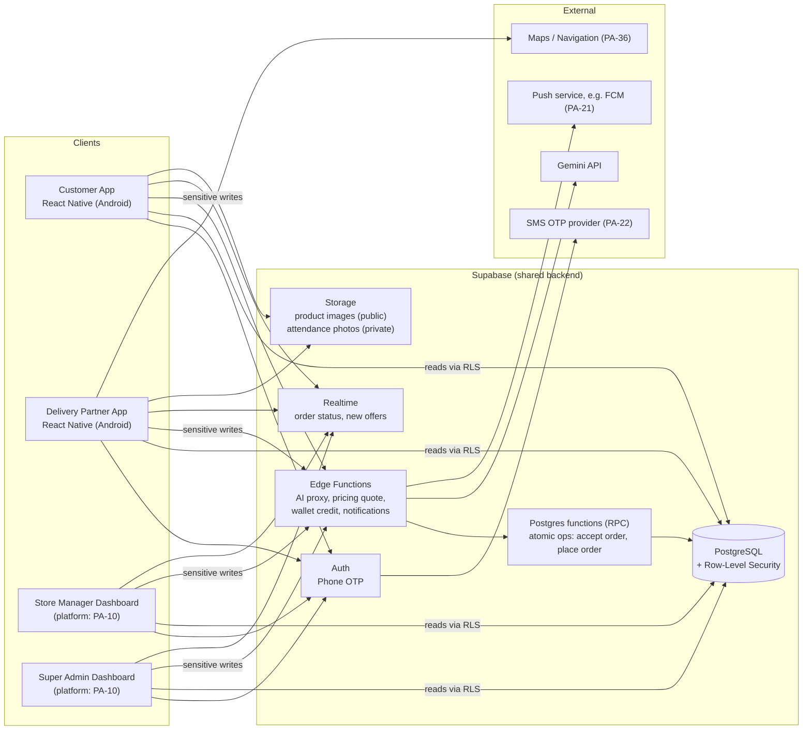
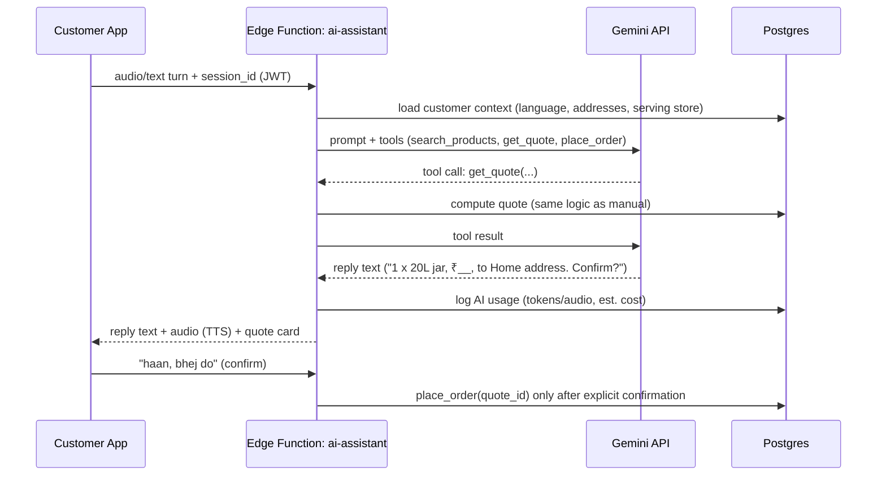

# Ramu Kaka — System Architecture

| Field | Value |
|---|---|
| Status | **PROPOSED – awaiting approval** |
| Confirmed inputs | Tech stack and architecture requirement from `[PDF §7]` |

> Everything below the "Confirmed constraints" section is a **RECOMMENDATION** unless it is marked CONFIRMED. Choices that depend on open decisions cite the `PA-xx` item.

---

## 1. Confirmed Constraints `[PDF §7]`

1. Mobile apps are built with **React Native + TypeScript**. Android builds use **Android Studio**.
2. **Supabase Auth** (OTP), **Supabase PostgreSQL**, and **Supabase server-side functions**.
3. **Gemini API** for the AI assistant.
4. **One shared backend and one database** for all panels, with **role-based access control**.
5. Wallet credits, order assignment, pricing and financial calculations are **validated server-side**.
6. **No API keys in the mobile app.**
7. GitHub for version control. Google Stitch for UI design.

## 2. High-Level Architecture



## 3. Component Responsibilities

| Component | Responsibility | Notes |
|---|---|---|
| **Customer App** | Onboarding, addresses, catalog, cart, voice assistant UI, order tracking, wallet, coupons, reviews | Holds only the public Supabase anon key, which RLS protects |
| **Delivery Partner App** | Duty toggle, attendance photo, order offers, accept/reject, status updates, COD entry, failure reports | Needs camera, location and push permissions |
| **Store Manager Dashboard** | Store operations for **one** store | Platform **PA-10** |
| **Super Admin Dashboard** | Platform-wide administration and finance | Platform **PA-10** |
| **Supabase Auth** | Phone OTP for all user types (DP method **PA-15**). Issues JWTs. | Custom role claims, or a lookup in the `user_roles` table |
| **PostgreSQL + RLS** | System of record. Enforces BR-01 (store isolation) at the data layer. | See [DATABASE_SCHEMA.md](./DATABASE_SCHEMA.md) |
| **Postgres functions** | Transactional business operations where atomicity matters (order accept, order placement with stock check, ledger writes) | Satisfies BR-03 and BR-05 |
| **Edge Functions** | Orchestration and calls to third parties: AI proxy, quotes, notifications, admin wallet credit | Secrets live here only (BR-22) |
| **Storage** | Product images (public bucket); attendance photos and issue photos (private bucket) | Retention **PA-34** |
| **Realtime** | Pushes order status changes and new-offer events to subscribed clients | Lowers polling load on weak networks |

## 4. Key Architectural Decisions

### ADR-01 Shared backend with RLS — CONFIRMED (PDF), design is RECOMMENDED
All panels use the same Supabase project. **Reads** go directly to Postgres, and RLS policies limit them by role and store. **Writes that involve money, price, assignment or status** go through Edge Functions or Postgres functions only. These tables do not allow direct client INSERT or UPDATE.

### ADR-02 Atomic order assignment — required by BR-03 and BR-10
Accepting an order is one conditional database update: *"assign this order to DP X only if it has no DP yet and is still waiting for assignment"*. If zero rows change, someone else already accepted it. This gives first-accept-wins without race conditions. Acceptance timeout and escalation to the manager depend on **PA-03** and **PA-40**.

### ADR-03 Server-side quote → confirm — required by BR-04, BR-12, BR-13, BR-21
1. The client (manual UI or AI) requests a **quote**: items, address, coupon. The server checks the service area, store open state, stock, price, surge, coupon and charges. It returns a short-lived `quote_id` with a breakdown.
2. The customer confirms. The client sends `place-order(quote_id, idempotency_key)`.
3. The server re-checks validity (store still open, stock still available) and creates the order in a single transaction.

The AI assistant uses **the same two endpoints** as the manual UI, so voice ordering cannot skip any business rule.

### ADR-04 AI assistant as a server-side tool-using agent — required by §5 and §7

- The Gemini key is stored only in Edge Function secrets (BR-22).
- Tool calls connect the model to real data (FR-AI-08). The model never states a price it did not receive from a tool.
- `place_order` can be called only after a confirmation turn **and** with a valid `quote_id` (FR-AI-05).
- Voice pipeline choice (**PA-23**). Options:
  - **(a)** Send audio directly to Gemini (multimodal input) and use Gemini or Google TTS for output.
  - **(b)** Use on-device or cloud speech-to-text first, then Gemini on text.
  - *Recommendation:* prototype (a) and (b) in Level 9 and measure Bhojpuri accuracy and cost before choosing.

### ADR-05 Append-only wallet ledger — required by BR-05, BR-17, BR-18
The wallet balance is the sum of ledger entries. Corrections are made by adding reversing entries, never by editing or deleting. Credits come only from Edge Functions that check the role and policy.

### ADR-06 Dashboards platform — **PENDING (PA-10)**

| Option | Pros | Cons |
|---|---|---|
| A. Web app (React + TS) **(recommended)** | Better for tables, reports and data entry on desktop; shares TS types and API client | One more codebase (can share a monorepo) |
| B. Inside the React Native app (role-based screens) | One codebase; matches the PDF stack literally | Reports and tables are awkward on phones |
| C. React Native Web | One UI codebase | Extra complexity and tooling friction |

### ADR-07 App packaging — **PENDING (PA-11)**
Recommendation: two Android apps (Customer, Delivery Partner) in one monorepo with shared packages. This keeps the customer app small and simple, and gives the DP app different permissions (camera, background location).

## 5. Proposed Repository Layout (RECOMMENDATION, not created yet)

```
ramukaka/
├── apps/
│   ├── customer/          # React Native (Level 4+)
│   ├── delivery/          # React Native (Level 6+)
│   └── dashboard/         # Manager + Admin (platform per PA-10)
├── packages/
│   ├── shared-types/      # generated DB types, API contracts
│   ├── i18n/              # hi / en / bho string catalogs
│   └── ui/                # shared design tokens/components
├── supabase/
│   ├── migrations/        # SQL migrations (Level 2+)
│   ├── functions/         # Edge Functions
│   └── seed/              # non-production seed data
├── docs/                  # this documentation
├── CLAUDE.md
└── README.md
```
No code, migrations or React Native projects exist yet. They are created only at their approved level.

## 6. Environments (RECOMMENDATION)

| Env | Purpose | Data |
|---|---|---|
| `local` | Developer machines (Supabase CLI) | Seed data |
| `staging` | QA and UAT, internal APK builds | Synthetic data |
| `production` | Live pilot (Jamui) | Real data |

Secrets (Gemini key, SMS provider credentials, service-role key) live only in Supabase project secrets and CI secrets. They are never committed.

## 7. Security Architecture

| Concern | Control |
|---|---|
| Authentication | Supabase phone OTP. JWT on every request. |
| Authorization | `user_roles` + store assignment, enforced by RLS (BR-01, BR-07) |
| Secrets | Server-side only (BR-22). Mobile apps have only the anon key. |
| Sensitive ops | Edge Functions / Postgres functions with role checks (BR-21) |
| Money integrity | Append-only ledger, idempotency keys, audit log |
| PII | Customer phone and address visible to the assigned DP only (RECOMMENDATION). Masked calling is **PA-24**. |
| Files | Private bucket + signed URLs for attendance and issue photos |
| Abuse / cost | OTP rate limits; AI usage logging (BR-08). Caps are **PA-35**. |

## 8. Notifications (RECOMMENDATION, channel **PA-21**)

| Event | Recipient |
|---|---|
| Order placed | Customer (confirmation), eligible DPs (offer), store manager |
| Order accepted / picked up / out for delivery / delivered | Customer, manager |
| No acceptance within timeout (**PA-03**) | Manager |
| Delivery failed / issue reported | Customer, manager |
| Wallet credited | Customer |
| Attendance photo submitted | Manager |

## 9. Scalability Path (Phase 3)
- Categories, stores and service areas are data, not code (NFR-SCALE-01).
- More districts are added as new stores and service areas.
- Analytics can later move to read replicas or a warehouse if reporting load grows (Phase 2/3).
