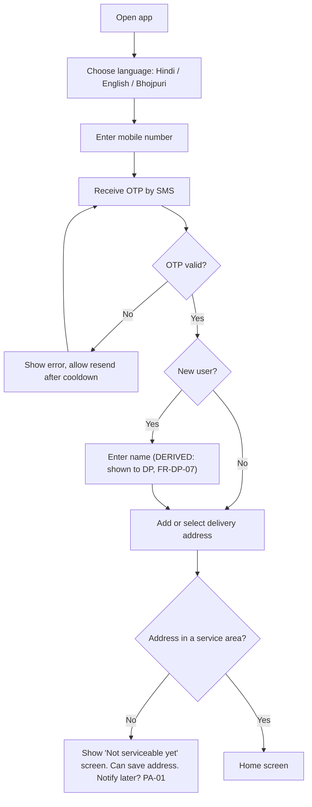
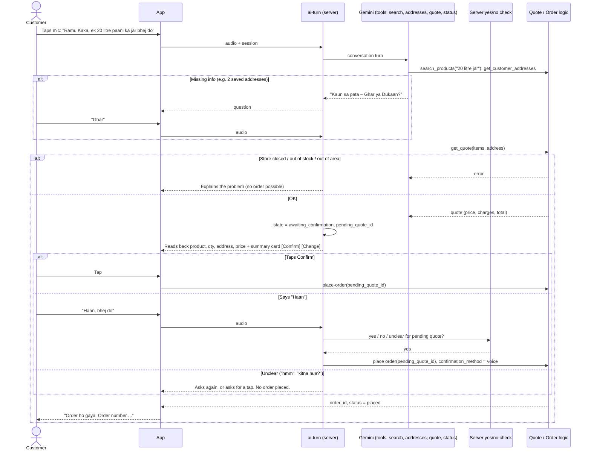
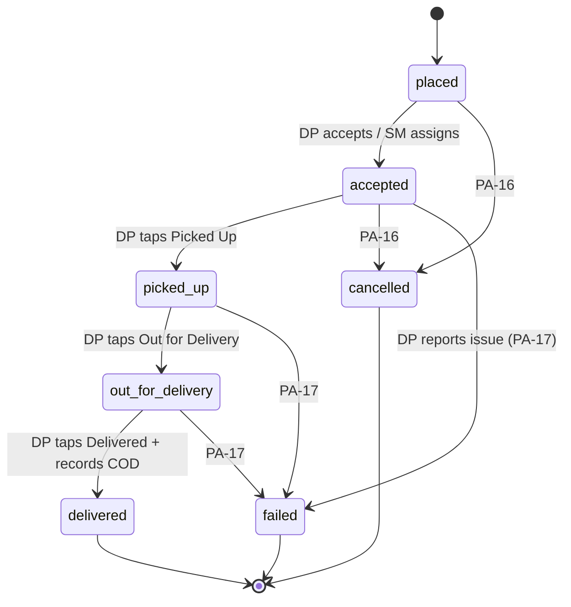

# Ramu Kaka — User Flows

| Field | Value |
|---|---|
| Status | **DRAFT** |
| Last updated | 2026-10-30 (audit corrections) |

> Flows are built from the confirmed requirements. Branches that depend on an open decision are marked **PA-xx**. Diagrams use Mermaid. Status values are lowercase snake_case. "Delivery request" means a dispatch to a DP; "offer" means a promotional offer.

---

## UF-01 Customer Onboarding (FR-CU-01/02/03)



## UF-02 Voice Order (FR-AI-01…08, BR-04, BR-12, BR-13, DR-10)

The model can look up products and request quotes. **Only the server places the order**, after a tap or a server-checked voice "yes" (ADR-04).



**Fallback (FR-AI-06):** after repeated recognition failures (threshold RECOMMENDED as 2), or if the customer taps "Order manually", the app opens UF-03 with any items already understood pre-filled.

## UF-03 Manual Order (FR-CU-04/06/07/12)

1. Home → choose a category (Water) → choose a product (e.g. 20 L jar).
2. Set quantity → **Review order**.
3. The app requests a server quote (`quote-order`). The summary shows items, price, delivery charge, surge (if any), discount, total, address and payment method (COD).
4. Optional: apply a coupon, which triggers a new quote. Wallet use is **PA-27**.
5. Tap **Confirm order**, which calls `place-order(quote_id)`.
6. If the price or stock changed since the quote, show the new summary and ask the customer to confirm again.
7. Confirmation screen → Order tracking.

## UF-04 Dispatch and Acceptance (FR-DP-04/05/06, BR-03, BR-10)

```mermaid
sequenceDiagram
  participant BE as Backend
  participant DP1 as Delivery Partner 1
  participant DP2 as Delivery Partner 2
  participant SM as Store Manager
  BE->>DP1: Delivery request (push + in-app; contents PA-56)
  BE->>DP2: Delivery request (push + in-app; contents PA-56)
  DP2->>BE: Accept
  BE->>BE: Atomic assign: only if unassigned and status = placed
  BE-->>DP2: Assigned ✅ (customer details now visible)
  BE-->>DP1: Request withdrawn
  DP1->>BE: Accept (late)
  BE-->>DP1: 409 ORDER_ALREADY_ASSIGNED
  BE->>SM: Order accepted by DP2
  Note over BE,SM: Who receives requests (all on-duty vs nearest),<br/>timeout and escalation = PA-03 / PA-40
  alt Nobody accepts within timeout (PA-03)
    BE->>SM: Alert: unassigned order
    SM->>BE: Manually assign (FR-SM-02)
  end
```

## UF-05 Delivery Execution and COD (FR-DP-07…10, BR-11)


> `placed`, `cancelled` and `failed` are proposed statuses (**PA-39**). The PDF confirms only the four DP statuses. Stock handling on each transition is **PA-49**.

At **delivered**, the DP enters the cash collected. If it differs from the order total, the record is flagged for the manager (**PA-08**).

## UF-06 Delivery Partner Shift (FR-DP-02/03/12)

1. Login (phone OTP, BR-26; extra checks **PA-15**) → Home.
2. Toggle **On Duty** → the app requests the work-start photo at the warehouse (store = warehouse is **PA-54**).
3. Photo uploaded (plus location and time, **PA-06**). Attendance is `pending` verification.
4. The DP becomes eligible for delivery requests. Whether requests wait until the photo is verified is **PA-06**.
5. During the shift: UF-04 and UF-05.
6. Toggle **Off Duty** → attendance closed. Daily summary shows deliveries and COD collected.
7. COD hand-over to the manager (**PA-08**).

## UF-07 Failed Delivery (FR-DP-11)

1. On an active order, DP taps **Problem**.
2. Selects a reason (list **PA-17**, e.g. customer not reachable, wrong address, customer refused) and adds a note or photo.
3. The order moves to `failed` (or a retry state, **PA-17**). Customer and manager are notified.
4. Manager reviews it. Stock restoration follows **PA-49** and **PA-17**. Customer communication follows **PA-17**.

## UF-08 Store Manager Daily Operations (FR-SM-01…15)

1. Login (phone OTP) → Overview.
2. **Open store** (manual toggle; schedule is **PA-33**; precedence with admin settings is **PA-50**).
3. Check DP attendance and verify start photos.
4. Update stock for water products (server function, audit-logged, DR-11).
5. Monitor the orders board. Handle unassigned-order alerts by assigning manually.
6. Optionally apply surge or extra delivery charges within admin limits (**PA-05**).
7. Review complaints, feedback and reviews (**PA-25**, **PA-26**).
8. End of day: reconcile COD per DP → mark settled (**PA-08**). **Close store.**

## UF-09 Product and Category Management (FR-SM-06…10)

1. Categories → **Add category** (name in each language, icon) → Save. (Server function; permission **PA-32**.)
2. Products → **Add product** → category, names and descriptions, unit, price (**PA-02**), stock, images → Save.
3. **Deactivate** instead of delete. Deactivated items disappear from the customer app and the AI catalog.
4. Stock adjustment: enter a new quantity or a +/- change with a reason. Every change creates a `stock_movements` entry (DR-11).

## UF-10 Super Admin: Store, Manager & Delivery Partner Setup (FR-SA-01/03/04/12)

1. Stores → **Create store** (name, address, location, service area **PA-01**).
2. Configure store settings and limits (delivery charges **PA-19**, surge cap **PA-05**, request timeout **PA-03**).
3. Managers → **Create manager** (phone) → assign to store → set permissions (**PA-32**) → approve.
4. Delivery partners → **Create / approve DP** → assign to store (onboarding and KYC **PA-14**).
5. The manager logs in by OTP and sees only that store.
6. Suspend a store, manager or DP at any time. Suspension blocks access **immediately**, including any login session that has not expired (DR-08).

## UF-11 Wallet Credit by Super Admin (FR-SA-07, BR-05, BR-18)

1. Customers → select a customer → **Credit wallet**.
2. Enter amount, type (cashback / refund / compensation) and a required reason or reference (e.g. a complaint).
3. Confirmation dialog shows the amount and the customer.
4. Server creates an append-only ledger entry, serialized per wallet, recording the approver. Customer is notified.
5. Mistakes are fixed with a **reversal** entry, never by editing.
6. Two-step approval is **PA-44**. Whether anyone other than the Super Admin can credit is **PA-52**.

## UF-12 Coupon / Cashback Campaign (FR-SA-06, FR-SM-13)

1. Offers → **New coupon** or **New cashback campaign**.
2. Scope: platform (SA) or own store (SM, if permitted).
3. Rules: value, minimum order, validity, usage limits. Policy is **PA-04**, **PA-29**, **PA-30**.
4. Activate. The offer appears to eligible customers and is validated at quote time.
5. How cashback reaches wallets (automatic or admin-approved) is **PA-52**.
6. Spend is tracked in finance reports (FR-WP-07, KPI-08).

## UF-13 Review, Complaint & Feedback (FR-CU-13, FR-SM-14, FR-SA-10)

1. After delivery, the customer is prompted to rate the product(s) (eligibility **PA-25**).
2. The review appears in the manager dashboard. Moderation and replies are **PA-25**.
3. Complaints and feedback: intake channel and whether feedback is a separate type are **PA-26** → manager handles → may escalate to SA → may lead to a wallet compensation (UF-11).

## UF-14 AI Cost Monitoring (FR-SA-11, BR-08)

1. Every Gemini API call logs usage server-side, grouped by turn and session.
2. SA → AI Usage: total spend, spend per customer, spend per completed order, voice vs manual conversion.
3. Reporting currency and exchange rate are **PA-57**. Thresholds and alerts or caps are **PA-35**.
